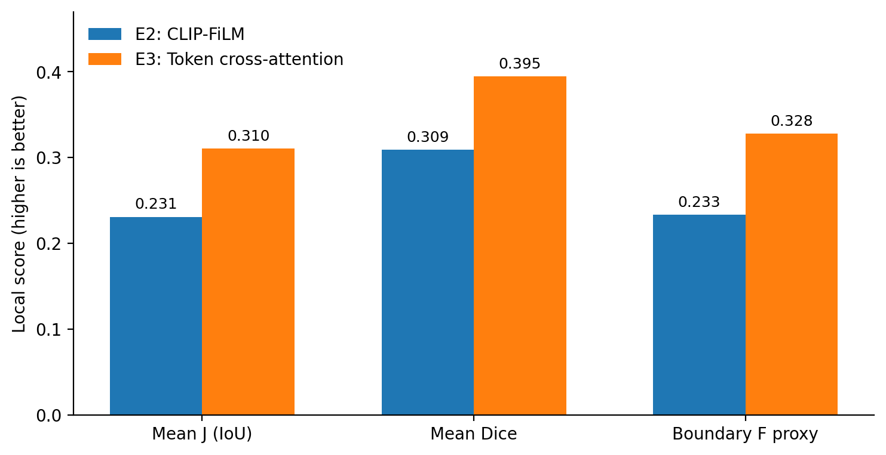
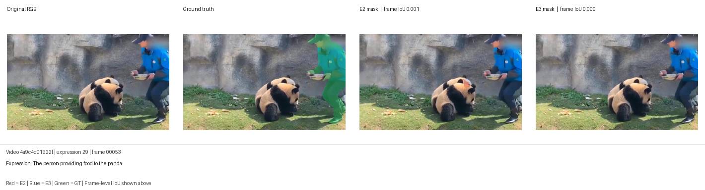
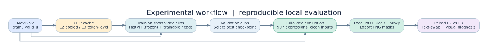

# UniVision-X

### Efficient text-guided video object segmentation with FastViT, CLIP and temporal modeling

**An experimental PyTorch project investigating how a language description can guide the segmentation of a moving object over time.** Developed and evaluated on **MeViS v2** using an NVIDIA RTX 2080 Ti (11 GB).

[](https://www.python.org/) [](https://pytorch.org/) [](https://github.com/henghuiding/MeViS) [](#scope-and-limitations)

> **Result at a glance.** On 907 MeViS `valid_u` referring expressions, the upgraded E3 system reaches **0.3103 local mean IoU**, compared with **0.2308** for our E2 baseline: **+7.95 percentage points**. **These are resized-image, local validation metrics, not the official MeViS J&F score.**


**[Lire en français / French summary](README_FR.md)**

**Navigation:** [Problem](#1-research-problem) · [Architecture](#2-architecture-e2-vs-e3) · [Quantitative results](#3-quantitative-results) · [Qualitative comparisons](#4-qualitative-results-real-model-predictions) · [Language grounding](#5-is-the-model-sensitive-to-language) · [Reproduce](#6-reproduce-the-experiments) · [Repository structure](#7-repository-structure) · [Limitations](#8-scope-and-limitations) · [References](#9-acknowledgments-and-references)

---

## 1. Research problem

**Referring video object segmentation (RVOS)** asks a model to delineate the object described by a free-form sentence across a video, instead of segmenting all prominent objects. The description may refer to **appearance**, **relationships** or **actions over time**.

For example, *"the rabbit that shifted its position"* refers to **one** of two visually similar rabbits; *"the person providing food to the panda"* refers to the **person**, not the panda. The target may also disappear or be absent from individual frames. A successful system therefore needs to jointly address:

- **Visual representation:** detect spatial features useful for segmentation.
- **Language grounding:** align the referred expression with the correct visual instance.
- **Temporal modeling:** preserve useful context between consecutive frames.
- **Target absence:** avoid predicting unrelated objects when the referent is not visible.

UniVision-X compares two successive model designs, **E2** and **E3**, holding the main visual backbone family and video-segmentation task fixed. E3 introduces *several* changes; this comparison is **not** a single-variable ablation.

## 2. Architecture: E2 vs E3

### 2.1 Shared visual and temporal backbone

Both experimental systems use a pretrained **FastViT-T8** feature extractor from `timm`, a lightweight multi-scale feature pyramid (FPN), a **ConvGRU** recurrent unit and a pixel-wise segmentation head. The reported models keep the FastViT encoder **frozen** to reduce the cost of training on a single 11-GB GPU.

For an RGB frame `$I_t$` and a referring sentence `$s$`, the model predicts a binary mask `$\hat{M}_t$` at each video time step. The temporal hidden state is carried across frames and, during full-video evaluation, across adjacent inference chunks.

### 2.2 E2 — global CLIP conditioning via FiLM

1. Encode the sentence using pretrained CLIP and cache a **single pooled 512-dimensional embedding**.
2. Extract and fuse multi-scale FastViT image features.
3. Apply **FiLM-like, channel-wise scale and shift** from the pooled text vector.
4. Process the conditioned feature maps with ConvGRU, then predict segmentation masks.

**Hypothesis tested by E2:** lightweight global language conditioning may help localize referred video objects without fine-tuning the visual backbone.

**Observed limitation:** on visually ambiguous examples, E2 often selects an incorrect object or more than one similar instance.

### 2.3 E3 — spatial cross-attention and target-presence prediction

E3 uses **token-level hidden states from pretrained CLIP**, instead of only a pooled sentence vector:

1. **Text branch:** cache up to 32 CLIP tokens per expression, with an attention mask.
2. **Visual branch:** extract multi-scale FastViT features and fuse them with FPN.
3. **Spatial text grounding:** project text tokens to the feature dimension; apply multi-head cross-attention, with **pooled spatial visual queries** and **text-token keys/values**. Interpolate the context map to the FPN resolution and add it residually.
4. **Temporal reasoning:** update ConvGRU state for each frame.
5. **Two predictions:** a segmentation logit map and a **per-frame target-presence logit** from pooled temporal visual and text features.
6. **Output masking:** at inference, a presence score above **0.5** is required for a binary mask to be retained.

The reported E3 configuration uses **4 attention heads**, an attention grid capped at **28 × 28**, feature width **48**, input size **224 × 224**, and clips of **3 frames** for training. Both pretrained encoders are frozen; the fusion, temporal, segmentation and presence components are trained.

The presence head is supervised jointly with segmentation, with reported loss weighting `presence_weight=0.5`. This helps formulate *when not to segment* as an explicit learning target; it does not guarantee correct absence handling.

For an expanded module-level explanation and a source-editable Mermaid diagram, read **[Architecture Notes](docs/ARCHITECTURE.md)**. The SVG diagram above also has an editable [Graphviz source](docs/diagrams/model_architecture.dot).

---

## 3. Quantitative results

### 3.1 Same validation split, full-video inference

**Data:** MeViS v2 `valid_u` · **907 referring expressions** · clean inputs · complete sequences · one run per model. Values below are **local resized-image metrics** from the supplied evaluation logs; `boundary_F_proxy` is a fixed-pixel approximation, **not official MeViS boundary F**.

| Local metric ↑ | E2 · pooled CLIP + FiLM | E3 · token cross-attention + presence | E3 − E2 |
|:--|--:|--:|--:|
| **Region IoU / J** | 0.2308 | **0.3103** | **+0.0795** |
| **Dice** | 0.3091 | **0.3946** | +0.0855 |
| Boundary F **proxy** | 0.2333 | **0.3279** | +0.0946 |
| (J + F proxy) / 2 | 0.2321 | **0.3191** | +0.0870 |
| FPS measured inside model-evaluation loop* | 135.0 | 124.1 | −8.1% |

*Indicative throughput excludes input image loading; not a standardized end-to-end benchmark. Higher segmentation accuracy comes with some additional computation.*



Across the **907 matched expressions**, **612 (67.5%) improved**, **247 (27.2%) worsened**, and **48 (5.3%) were approximately unchanged**. The mean paired IoU change is **+0.0795**, while the **median change is +0.0246**. The distribution matters: E3 is better overall, but **not on every example**.

### 3.2 E3 training evolution

The E3 run completed **12 epochs** on an **RTX 2080 Ti**. Training used AdamW (`lr=2e-4`, `weight_decay=1e-4`), batch size 1, gradient accumulation 2, mixed precision, seed 43 and training-time corruption augmentation with probability 0.3. The encoder was frozen.


The selected checkpoint is **epoch 6** (local validation `val_macro_j=0.3053`, `val_present_frame_j=0.2941`), chosen by the project-specific score `present-frame J − 0.1 × absent-target false-positive rate`. These **3-frame validation scores must not be compared directly** with the full-video table above.

**Detailed evidence:** [Experimental protocol and diagnostics](docs/EXPERIMENTS.md) · [Reproducibility notes](docs/REPRODUCIBILITY.md) · [Machine-readable summaries](results/)

---

## 4. Qualitative results: real model predictions

The following panels come from **actual E2 and E3 exported predictions** on identical MeViS frames, paired with the dataset ground truth. **Red = E2**, **blue = E3**, **green = ground truth**. Displayed IoU numbers are **frame-level**, not expression averages. Figure selection illustrates improvement and a limitation; **the quantitative comparison above covers all 907 expressions**.

### Example A — Correct instance among two similar rabbits

**Referring expression:** *"The rabbit that shifted its position."* The GT is the lower-left rabbit. E2 incorrectly highlights the other rabbit; E3 shifts toward the correct target. This is the clearest available example of improved referring-instance selection.

**Selected frame IoU: E2 = 0.041 → E3 = 0.459.**


### Example B — Dog moving in a group

**Referring expression:** *"A dog facing off with a monkey and constantly changing its position."* E3 modestly improves overlap with the GT, while both models still include incorrect regions. This is a more realistic case of **partial improvement**, not a perfect result.

**Selected frame IoU: E2 = 0.351 → E3 = 0.387.**


<details>
<summary><strong>Failure analysis — person feeding pandas (click to expand)</strong></summary>

**Referring expression:** *"The person providing food to the panda."* Both models struggle on the displayed frame; E3 produces no useful mask. This is a reminder that higher mean performance does **not** eliminate individual-frame grounding errors.

**Selected frame IoU: E2 ≈ 0.001; E3 = 0.000.** (The expression-level averages on this video differ because they include other frames.)



</details>

**Image source and rights:** these are visualization composites derived from the **MeViS** dataset. MeViS imagery remains subject to the original dataset's **CC BY-NC-SA 4.0 non-commercial terms**; figures are credited to the dataset authors, adapted with our model-mask overlays. Confirm distribution conditions before republishing. The repository **does not redistribute the original dataset, annotations or checkpoints**. See [Data and licensing notes](docs/DATA_AND_LICENSE.md).

To regenerate comparable figures from your own exported predictions (without new inference):

```bash
python scripts/make_qualitative_comparisons.py \
  --data data/MeViS_release/valid_u \
  --e2 outputs/E2_eval_clean \
  --e3 outputs/E3_eval_clean \
  --out outputs/qualitative_e2_e3
```

The original per-case numbers are in [`results/qualitative_manifest_selected.csv`](results/qualitative_manifest_selected.csv). Avoid reporting selected qualitative cases as representative statistics.

---

## 5. Is the model sensitive to language?

To test whether referring expressions affect predictions, we ran a **paired text-swap diagnostic** on 100 sampled expressions: use the same video, but replace its correct description with a second description from the same video (seed 43).

| Diagnostic on matched 100 expressions | E2 | E3 |
|:--|--:|--:|
| Mean local J with **correct** text | 0.2057 | **0.2978** |
| Mean local J with **swapped** text | 0.1786 | 0.2238 |
| **Correct-text IoU advantage** | +0.0272 | **+0.0740** |
| Fraction of binary mask pixels that change | 4.09% | **5.25%** |
| Frames with non-empty prediction when target absent (same 1,020 frames) | 752 (73.7%) | **331 (32.5%)** |

**Interpretation:** E3 shows greater sensitivity to the supplied description on average, and fewer non-empty masks on absent-target frames in this diagnostic. However, **only 56%** of the E3 text-swap pairs favor the correct description, and some swapped descriptions refer to the **same target**. When limited to **60 pairs with disjoint annotation IDs**, the correct-text IoU advantage is **+0.0381 (E2)** vs **+0.0537 (E3)**. These results support a **limited, measured improvement**, not a proof of broad language comprehension.

For the **full E3 validation evaluation**, **3,388 of 5,790** absent-target frames (58.5%) still had non-empty predictions (even one predicted pixel counts). This remains an important failure mode. See [Experiments](docs/EXPERIMENTS.md) for the bootstrap caveats and the full validation protocol.

---

## 6. Reproduce the experiments

### 6.1 Environment and requirements

The reported environment used Linux, Python **3.11.7**, CUDA GPU **RTX 2080 Ti (11 GB)**, `torch==2.7.0+cu118`, `torchvision==0.22.0+cu118`, `timm==1.0.30`, and `transformers==4.57.6`.

```bash
python3 -m venv .venv
source .venv/bin/activate
# Install PyTorch/torchvision for your CUDA environment first:
# https://pytorch.org/get-started/locally/
pip install -r requirements.txt
python -m pytest -q tests/
```

Tests use toy inputs and are **engineering smoke checks**, not benchmark replications. Pretrained CLIP and FastViT weights must be available from their official sources or a local model cache.

### 6.2 Dataset layout

Obtain MeViS from the authors: **[MeViS repository](https://github.com/henghuiding/MeViS)**. Dataset files, checkpoint weights and cached embeddings are **not included**.

```text
data/MeViS_release/
├── train/
│   ├── JPEGImages/<video_id>/<frame>.jpg
│   ├── meta_expressions.json
│   └── mask_dict.json
└── valid_u/
    ├── JPEGImages/<video_id>/<frame>.jpg
    ├── meta_expressions.json
    └── mask_dict.json
```

If the release supplies `meta_expressions_v2.json`, make the expected `meta_expressions.json` available without modifying annotation content. Ensure you follow the dataset license.

### 6.3 Build the two text caches

```bash
# E2: one pooled CLIP embedding per sentence
python -m univision.text_cache --data data/MeViS_release \
  --splits train valid_u --out outputs/clip_text.pt

# E3: padded token-level CLIP hidden states and masks
python -m univision.e3_text_cache --data data/MeViS_release \
  --splits train valid_u --max-length 32 --out outputs/clip_tokens_32.pt
```

### 6.4 GPU training and evaluation with SLURM

Submit from the **repository root**. Update SLURM partition/GRES/QoS/time to match your cluster; these example job files target `gpu-2080ti`.

```bash
mkdir -p logs outputs

# E2 (wait for each prior job to complete)
sbatch scripts/train_2080ti.sbatch
sbatch scripts/evaluate_2080ti.sbatch

# E3 (wait for each prior job to complete)
sbatch scripts/e3_preflight_2080ti.sbatch
sbatch scripts/e3_train_2080ti.sbatch
sbatch scripts/e3_eval_2080ti.sbatch
```

After evaluation, expect `summary.json`, `per_expression.csv`, and `Annotations/` with exported masks under `outputs/E2_eval_clean/` and `outputs/E3_eval_clean/`. Scripts support absolute project paths through `UNIVISION_PROJECT_DIR` if needed; **no personal HPC account or paths are required**.

### 6.5 Compare and diagnose

```bash
sbatch scripts/diagnose_text_2080ti.sbatch
sbatch scripts/diagnose_text_e3_2080ti.sbatch

python analyse_text_grounding_e2.py \
  --csv outputs/E3_text_diagnostic/per_expression.csv \
  --meta data/MeViS_release/valid_u/meta_expressions.json \
  --out outputs/E3_text_diagnostic/paired_analysis.json
```

For the detailed research workflow, see the [reproducibility guide](docs/REPRODUCIBILITY.md) and [experiment report](docs/EXPERIMENTS.md).



---

## 7. Repository structure

```text
UniVision-X/
├── univision/           # E2/E3 architecture, datasets, training & evaluation
├── scripts/             # SLURM jobs + post-processing/diagnostic tools
├── tests/               # Synthetic unit/smoke tests
├── configs/             # Research experiment configuration/planning
├── assets/
│   ├── architecture_e2_e3.svg
│   ├── research_workflow.svg
│   ├── e2_vs_e3.png
│   ├── e3_training_curve.png
│   └── qualitative/     # Curated REAL RGB/GT/E2/E3 comparisons
├── results/             # Lightweight measured metrics, no model weights
├── docs/                # Architecture, experiments, licensing, how to publish
├── requirements.txt
├── pyproject.toml
├── .gitignore
└── README.md
```

## 8. Scope and limitations

This repository is a **research/portfolio prototype**, not a claimed state-of-the-art MeViS method or published paper.

- **Local, resized-image evaluation.** J, Dice and boundary-F proxy are not the official MeViS J&F; run the authors' official implementation on correctly formatted original-resolution PNG predictions before any leaderboard comparison.
- **One training seed.** E2 and E3 are not supported by multi-seed confidence intervals; `valid_u` is also used for checkpoint selection, and is **not an independent held-out test set**.
- **Multiple changes in E3.** Cross-attention, target-presence gating and training details changed together; their individual contributions require controlled **ablations**.
- **Incomplete grounding.** Both models can choose the wrong instance, especially when relations and motion are ambiguous.
- **Target absence remains difficult.** The E3 full-video false-positive rate on absent-target frames is still **58.5%** using the strict non-empty-mask definition.
- **Performance reporting:** model-only FPS excludes data loading and does not benchmark deployment latency or power consumption.
- **Optional exploratory code** (e.g., SAM2 teacher utilities, SSL and generative prototypes) should **not** be treated as part of the validated E2/E3 pipeline.
- **Code provenance:** assembled from available E2 source files and E3 patches. If your HPC checkout has additional edits, synchronize the exact files before claiming bit-for-bit reproduction.

## 9. Acknowledgments and references

- **MeViS / dataset:** Ding et al., [MeViS: A Large-scale Benchmark for Video Segmentation with Motion Expressions](https://github.com/henghuiding/MeViS). Dataset original frames and masks belong to their respective authors.
- **FastViT:** pretrained `fastvit_t8.apple_in1k` via [timm](https://github.com/huggingface/pytorch-image-models).
- **CLIP:** `openai/clip-vit-base-patch32` through [Hugging Face Transformers](https://github.com/huggingface/transformers).
- **Framework:** [PyTorch](https://pytorch.org/).

**Repository licensing:** no license for the source code is implied by this archive. Choose a code license only after checking ownership and institutional/collaborator permissions. The MeViS image composites remain separately governed by the original **CC BY-NC-SA** dataset terms. See [data and licensing](docs/DATA_AND_LICENSE.md) and the [French publication guide](docs/PUBLISH_ON_GITHUB_FR.md).
