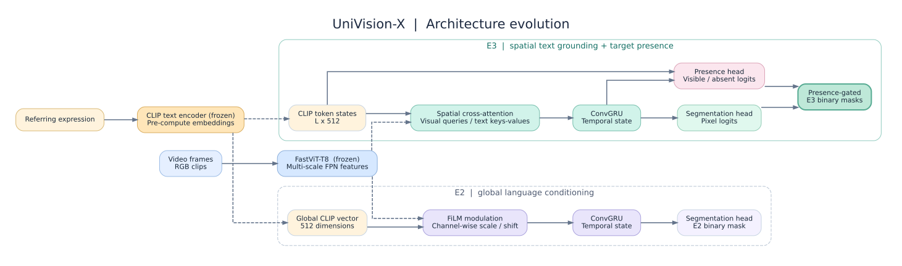
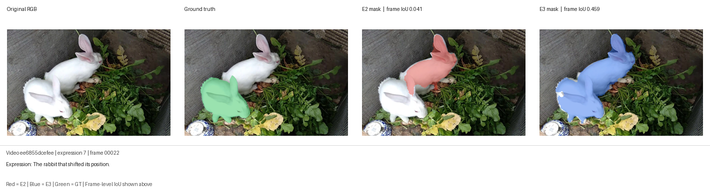
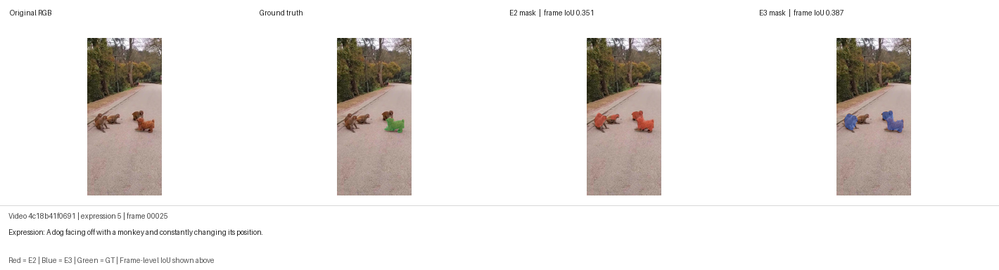

# UniVision-X — Présentation en français

> Le [README principal en anglais](README.md) constitue la documentation complète du dépôt. Ce fichier est un résumé en français, destiné à faciliter la présentation du projet dans un dossier de candidature.

## Le problème scientifique

UniVision-X étudie la **segmentation d’objets dans des vidéos à partir d’une description en langage naturel** (*Referring Video Object Segmentation*, RVOS). Le système reçoit une vidéo et une phrase comme « le lapin qui a changé de position », puis doit produire le masque du **bon objet** pour chaque image, y compris lorsque plusieurs instances se ressemblent ou que la cible disparaît.

## Ce qui a réellement été développé

| Élément | E2 — baseline | E3 — modèle amélioré |
|---|---|---|
| Vision | FastViT-T8 préentraîné, gelé | Même famille FastViT-T8, gelé |
| Texte | Embedding global CLIP (512 dimensions) | Représentations CLIP des tokens |
| Fusion | FiLM global | Cross-attention spatiale |
| Temps | ConvGRU | ConvGRU |
| Masque | Tête de segmentation | Tête de segmentation + présence de la cible |
| Entraînement | PyTorch + SLURM + RTX 2080 Ti | PyTorch + SLURM + RTX 2080 Ti |

Les résultats ci-dessous proviennent du split de validation **MeViS v2 `valid_u` (907 expressions)**, avec une évaluation locale sur vidéos complètes. **Il ne s'agit pas des scores officiels J&F de MeViS.**

| Mesure locale | E2 | E3 |
|---|---:|---:|
| IoU / J moyen | 0,2308 | **0,3103** |
| Dice | 0,3091 | **0,3946** |
| Boundary F proxy (non officiel) | 0,2333 | **0,3279** |

L'amélioration d'IoU est de **+7,95 points** et concerne **612 des 907 expressions**. E3 est cependant moins bon que E2 sur **247 expressions** : le modèle reste un prototype de recherche.

## Résultats visuels

### Cas favorable : lapin

La vérité terrain (vert) désigne le lapin du premier plan. E2 (rouge) se concentre sur l'autre lapin, tandis que E3 (bleu) sélectionne davantage la bonne instance. **IoU sur cette image : 0,041 → 0,459.**

### Cas de progression modérée : chien

Le recouvrement progresse de **0,351 à 0,387** sur l'image sélectionnée, même si les masques ne sont pas parfaits.

Le README anglais contient aussi un **cas d'échec avec la personne nourrissant un panda**, pour montrer les limites du système.

## Organisation du dépôt

- `univision/` : modèles, préparation des données, apprentissage et évaluation.
- `scripts/` : SLURM et diagnostics pour serveur GPU.
- `tests/` : tests unitaires sur données synthétiques.
- `assets/` : diagrammes et résultats visuels réels.
- `results/` : métriques sauvegardées sous forme de fichiers légers.
- `docs/ARCHITECTURE.md` : explication technique détaillée.
- `docs/EXPERIMENTS.md` : protocole, résultats et limites.
- `docs/PUBLISH_ON_GITHUB_FR.md` : procédure de publication.

## Points de prudence scientifique

E3 change plusieurs composants en même temps : la comparaison E2/E3 **ne démontre pas à elle seule que le gain provient uniquement de la Cross-Attention**. Une vraie publication nécessiterait des ablations, des essais avec plusieurs graines et l'évaluation officielle MeViS.

Les données MeViS et les poids des modèles **ne sont pas inclus**. Les figures réutilisant les images de MeViS restent soumises à la licence du jeu de données. La mise en ligne du code doit également respecter les droits de ses auteurs et éventuels établissements partenaires.

Pour les étapes techniques et les commandes, consulte le [README principal](README.md).
