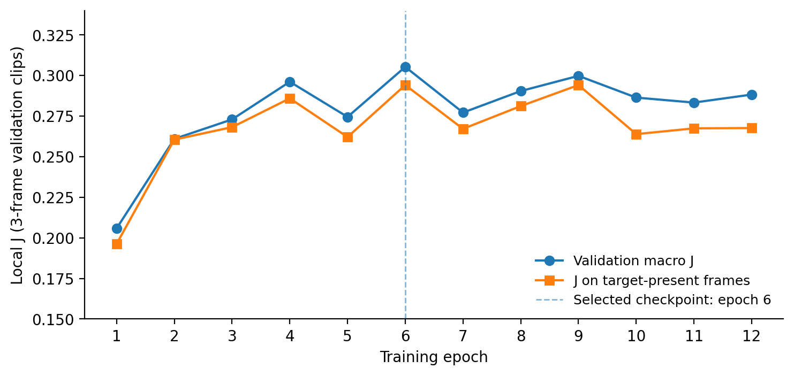

# Experimental report — UniVision-X

## Scope

This document records **locally measured experiments shared by the project operator**; it does not claim independently repeated training or benchmark leaderboard results. Protocol: MeViS v2 `valid_u` (907 referring expressions) with clean images, full-video evaluation. Train and evaluation code is included, but released scripts may differ from manually modified versions on the HPC server; check any code changes before claiming bit-for-bit reproducibility.

## Main results

| Metric | E2 | E3 | E3 − E2 |
|---|---:|---:|---:|
| Mean local J | 0.230774 | 0.310270 | +0.079496 |
| Mean local Dice | 0.309126 | 0.394590 | +0.085464 |
| Mean local boundary F **proxy** | 0.233335 | 0.327898 | +0.094563 |
| Mean local (J + proxy F) / 2 | 0.232055 | 0.319084 | +0.087029 |
| Model-only FPS, not standardized end-to-end | 135.0 | 124.1 | not directly comparable |

Paired expression-wise changes (907 common expressions): **612 improved**, **247 degraded**, **48 nearly unchanged** (tolerance `1e-6`). **Mean J gain = 0.079496**, **median J gain = 0.024621**.

The reported E3 full-video absent-target result is 3,388 false-positive frames out of 5,790 absent-target frames (**58.5%**); a single positive pixel counts as a false positive.

## Training details for E3

- Backbone: `fastvit_t8.apple_in1k` pretrained with ImageNet weights; backbone frozen.
- Language: token-level hidden states from pretrained `openai/clip-vit-base-patch32`, pre-computed and frozen.
- Text length: 32 tokens (24 training+validation descriptions were truncated when generating the cache).
- Fusion: multi-head cross-attention between spatial visual features and CLIP text tokens.
- Temporal: ConvGRU; segmentation output gated by presence prediction.
- 224 × 224 spatial resolution; 3 frames per training sample; `width=48`.
- 12 epochs, batch 1, gradient accumulation 2, AdamW LR 0.0002, weight decay 0.0001.
- Corruption augmentation probability 0.3; AMP enabled; seed 43.
- Validation metrics on 3 sampled frames per expression, not full-video.
- Selected checkpoint epoch **6** by `present-frame J − 0.1 × false-positive-absent-frame-rate`.
- E3 validation at epoch 6: `val_macro_j=0.305278`, `val_present_frame_j=0.294100`, `val_false_positive_absent_rate=0.601375`, `val_presence_accuracy=0.858140`.
- Validation set composition at checkpoint-selection time: 907 expressions × 3 sampled frames, 291 absent frames; always predicting "present" would yield approx. 89.3% presence accuracy. Hence raw accuracy should not be interpreted as a strong presence detector.

## Text sensitivity diagnostic

Both models were evaluated with correct vs. changed descriptions on 100 sampled expressions (seed 43), with unchanged videos. These are **paired tests of text sensitivity**, not direct measures of semantic correctness.

| Statistic | E2 | E3 |
|---|---:|---:|
| IoU, correct text | 0.205734 | 0.297802 |
| IoU, swapped text | 0.178583 | 0.223794 |
| IoU margin | 0.027152 | 0.074008 |
| Mean changed mask fraction | 0.040872 | 0.052468 |
| Number of absent frames | 1,020 | 1,020 |
| Non-empty false-positive frames when absent | 752 | 331 |

60 negative pairs had disjoint annotation IDs: margin E2 **0.038132** (bootstrap 95% CI [0.00526, 0.07390]); E3 **0.053713** (bootstrap 95% CI [0.00324, 0.11140]). These are conditional sample-based intervals; the correlation of expressions within videos is not modeled. Also, these are separate CIs, *not* a CI for the difference between E3 and E2.

Original related result artifacts are summarized in [`../results`](../results). Derived PNGs from the main evaluation and the trained checkpoints are not distributed.

## Interpretation, caveats, and claims

- E3 has improved local mean J by **7.95 percentage points** on this run and selection protocol.
- E3 improves on **67.5%** of matched expressions.
- Correct text provides a larger IoU gain on average in E3's 100-expression diagnostic.
- No individual module contribution has been isolated: E3 changes cross-attention, presence gating, training augmentation and checkpoint selection.
- The E2/E3 main results are based on one seed per model; confidence about generalization to other training runs requires repeats.
- The original MeViS evaluation implementation must be run for official boundary F and official J&F, with the expected folder names, original image resolution, and correctly encoded 0/255 PNG masks.
- The `valid_u` split was used for checkpoint selection and diagnostics, so it is a **development validation split**, not an independent hidden test set.

## Visual evidence and selected qualitative examples

The GitHub README now includes **real side-by-side E2/E3 predictions** on **the same source video frame**. The masks and ground-truth were exported from the completed evaluations. RGB/GT/E2/E3 panels are included in `assets/qualitative/`.

| Displayed frame | Reference | E2 frame J | E3 frame J | Interpretation |
|---|---|---:|---:|---|
| Rabbit, frame `00022` | Target is one of two similar rabbits | 0.040889 | **0.458633** | Clear gain in instance selection |
| Dog, frame `00025` | Dog moving within a group | 0.350680 | **0.387117** | Modest improvement; still imperfect |
| Panda, frame `00053` | Person feeding panda | 0.000829 | 0.000000 | E3 failure on selected frame; expression-level behavior differs |

See `results/qualitative_manifest_selected.csv` for the paired case metadata, including full-expression J. The **lapin/rabbit** and **chien/dog** examples lead the gallery; the **panda** appears under a collapsed “Failure analysis” panel so the README does not hide important limitations.

**Selection caveat:** these are intentionally curated figures, not an unbiased qualitative sample. They demonstrate what the models can and cannot do but **cannot establish average improvement**. The average improvements derive instead from the 907-expression local validation results.

The figure generation tool is `scripts/make_qualitative_comparisons.py`; it reads the completed E2 and E3 per-frame masks, chooses a center-nearest target-present image when possible, and records both frame-level and expression-level J. No new training or synthetic prediction is used.

The MeViS frames are subject to dataset terms: see [`DATA_AND_LICENSE.md`](DATA_AND_LICENSE.md).
